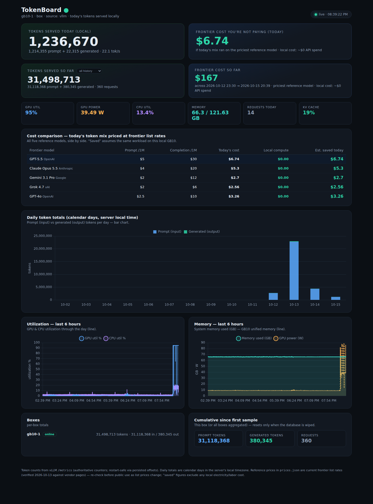

# TokenBoard

**Local inference, quantified.** TokenBoard runs on the box serving your local
model (GB10, DGX Spark, or any Linux box with vLLM), counts every token the
model serves, and shows live what that activity would have cost on frontier
APIs - so at the end of a tradeshow day you can say:

> *"We served 23M tokens today, locally, on this box. The same workload on
> the frontier API would have cost $X."*



One clone, one command, one browser tab:

```bash
git clone https://github.com/treymorton/tokenboard tokenboard && cd tokenboard
./install.sh
# open http://localhost:8100
```

## Requirements

- **Linux** (aarch64 or x86_64; built and tested on NVIDIA GB10)
- **Python 3.10+** - that's it. TokenBoard is stdlib-only; `install.sh`
  installs nothing and needs no root. Chart.js is vendored, so the dashboard
  works fully offline.
- **A local inference server: vLLM or llama.cpp** (llama-server) - the
  prerequisite. TokenBoard reads the server's cumulative Prometheus
  counters, which are exact: what the API would bill. vLLM is preferred
  when both are up; llama-server is auto-discovered on any local port
  (its ephemeral port doesn't need configuring). Ollama is supported for
  model-presence display.
- Internet is needed **only** for the optional price refresh at install time;
  a bundled price snapshot is used if the box is offline.

## What you get

- **Hero cards:** tokens served today (local) + frontier cost you're not paying
- **"So far" cards:** tokens + cost over a selectable time frame (all history,
  today, last 24 h, yesterday, last 7 days, last 30 days)
- **KPIs:** GPU util, GPU power, CPU util, memory, requests, KV cache
- **Cost comparison table:** all five frontier flagships side by side, with
  today's estimated savings per model
- **Daily bar chart:** prompt vs generated tokens per calendar day
  (server local time - set the box's timezone to the venue's before a show)
- **Line charts:** GPU/CPU utilization and memory/power, last 6 h
- **Boxes panel:** per-box online status + cumulative totals (hub mode)

## How install.sh works

1. checks Python ≥ 3.10
2. probes `127.0.0.1:8000` / `:8001` for a vLLM `/metrics` endpoint
   (override with `--vllm-url`); if none is found it still installs -
   TokenBoard samples GPU/CPU/memory immediately and starts counting
   tokens the moment vLLM **or** a llama-server (any port, auto-found
   via /proc) comes up
3. writes `config.json` from `config.example.json` (never clobbers an
   existing one); `box_name` defaults to the hostname
4. refreshes `prices.json` from OpenRouter's public API (no key); on failure
   keeps the bundled snapshot
5. installs and starts user systemd services (auto-start on boot,
   `Restart=always`) - or `nohup` with `--no-systemd`
6. health-checks the dashboard and prints the URLs (localhost + LAN IP)

```
./install.sh --port 8100 \
             --vllm-url http://127.0.0.1:8001 \
             --box-name gb10-2 \
             --hub-url http://10.0.1.5:8101 \
             --hub \
             --no-systemd
```

| flag | effect |
|---|---|
| `--port N` | dashboard port (default 8100) |
| `--hub-port N` | local hub port (default 8101) |
| `--vllm-url URL` | vLLM base URL (else auto-detected) |
| `--box-name NAME` | identity label (else hostname) |
| `--hub-url URL` | remote hub this box pushes to |
| `--hub` | also install a local hub (multi-box on one machine) |
| `--no-systemd` | run via nohup + `logs/` instead of user services |

## How token counting works (and why the numbers are exact)

vLLM exposes cumulative Prometheus counters: `prompt_tokens_total`,
`generation_tokens_total`, `request_success_total`. llama.cpp
(llama-server) exposes equivalent ones (`llamacpp:prompt_tokens_total` +
`prompt_tokens_cached_total`, `tokens_predicted_total`). TokenBoard
samples them every 2 s and stores the running cumulative value in SQLite.

- **Engine auto-detection, vLLM first:** each sample tries vLLM at
  `vllm_url`, then Ollama (status only, if configured), then
  auto-discovers any local llama-server LISTEN socket via /proc (its
  port is ephemeral, e.g. under Hermes). Multiple llama-servers are
  summed. Pin an endpoint with `llama_url` for llama in Docker (other
  net namespaces are invisible to /proc discovery).
- **llama requests & KV tiles:** derived from `/slots` (busy->idle
  edge counting; in-context tokens / n_ctx) - see Limitations for the
  exactness guarantees. State lives in `meta` (`llama_reqs`, `llama_busy`).
- **Restart-safe:** if the backend restarts and its counter drops, the
  sampler detects the regression and re-baselines a **persisted offset**
  so the cumulative series stays monotonic - no lost or double-counted
  tokens. The re-baseline is source-aware: a vLLM ↔ llama engine switch
  continues the cumulative seamlessly (a brief vLLM appearance while
  llama keeps running cannot double-count). Verified across a real
  machine reboot + vLLM restart (see `docs/OPERATIONS.md`) and a live
  vLLM → llama.cpp switch.
- **Box restart-safe:** offsets, last-seen counters, and the active
  source live in the `meta` table of the SQLite DB, so a TokenBoard
  restart mid-stream is seamless.
- **Daily totals** = (box's last cumulative within the day) − (box's last
  cumulative before the day), per box, summed across boxes, in the server's
  local timezone.
- **One caveat for fresh boxes:** a box that starts *mid-stream* (backend
  already running) attributes the counter's existing value to its first day.
  Start TokenBoard when the backend starts for clean day boundaries.
  The mirror case - TokenBoard already running when a *new engine* is
  adopted - continues at the old total, so the new engine's pre-switch
  tokens land in neither day nor growth; re-seed `meta` to re-attribute
  them (recipe in `docs/OPERATIONS.md`).
- Thinking tokens (e.g. Qwen3 reasoning) count as generated tokens - they
  are real output an API would bill.

## Configuration

`config.json` (generated by install.sh; edit + restart to apply):

| key | meaning |
|---|---|
| `box_name` | identity for aggregation; empty string = hostname |
| `role` | `box` (sample + serve) or `hub` (ingest + aggregate) |
| `port` | dashboard port |
| `vllm_url` | local vLLM base URL - preferred token source |
| `ollama_url` | fallback: Ollama status only (no counters - see Limitations) |
| `llama_url` | pin a llama-server endpoint (string or list); empty = auto-discover via /proc; set it when llama runs in Docker |
| `hub_url` | hub address for boxes to push to (`""` = standalone) |
| `sample_interval` | seconds between samples (default 2) |
| `db_file` | SQLite file name (default `tokenboard.db`) |

`TOKENBOARD_CONFIG=/path/to/config.json` runs an alternate instance (that's
how the hub uses `config-hub.json`).

## Multi-box (hub mode)

For a tradeshow with several GB10s: run one hub (e.g. on the booth laptop -
it has no vLLM and samples nothing) and point every box at it.

```
# hub machine
./install.sh --hub            # hub on :8101

# each box
./install.sh --hub-url http://<hub-ip>:8101
```

Boxes batch-push their full sample history every 5 s (idempotent,
restart-safe, catches up after network blips). The hub dashboard aggregates
all boxes with a per-box breakdown; append `?box=<name>` to any hub URL to
filter one box. All boxes should share the hub's timezone for clean daily
aggregation.

## Frontier prices

`prices.json` holds $/1M-token list rates for the comparison models
(default: GPT-5.5, Claude Opus 5.5, Gemini 3.1 Pro, Grok 4.7, GPT-4o).

- **At install time** `install.sh` fetches current rates from OpenRouter's
  public model API (free, no key) and rewrites `prices.json` with the fetch
  date. Offline → the bundled snapshot is kept (its date is visible in the
  dashboard's price table).
- **Later:** `python3 scripts/refresh_prices.py` (or `curl -X POST
  localhost:8100/api/prices --data @prices.json`). The dashboard reads the
  file per request - no restart.
- **Custom comparison set:** edit the `MODELS` list at the top of
  `scripts/refresh_prices.py`.
- Selection is conservative: `:batch` half-price variants excluded, preview
  tiers and ambiguity resolve to the *higher* rate, and every such choice is
  disclosed in the file's `note`. OpenRouter is a third-party relay (vendor
  pages block automated fetches) - re-verify against vendor pages before
  publishing dollar figures.

## Autostart & operations

User systemd services (installed by `install.sh`):

```bash
systemctl --user status tokenboard-box tokenboard-hub
systemctl --user restart tokenboard-box          # apply a config edit
systemctl --user disable --now tokenboard-box   # stop + no auto-start
journalctl --user -u tokenboard-box -n 50       # logs
```

Note: user services start at login; with `loginctl enable-linger <user>`
they start at boot without a login (needs root once). Without systemd, use
`./install.sh --no-systemd` or run `python3 tokenboard.py` directly.

## API

| endpoint | description |
|---|---|
| `GET /api/state` | live KPIs, today's totals + cost per model, cumulative |
| `GET /api/range?preset=&from=&to=&box=` | totals + cost over a window; `preset` ∈ `all`, `today`, `24h`, `yesterday`, `7d`, `30d` (local-time midnights); explicit `from`/`to` (ISO date or epoch) win |
| `GET /api/timeseries?box=X` | last 6 h samples (cpu, mem, gpu, power) |
| `GET /api/days?box=X` | 14 calendar days of token totals + costs |
| `GET /api/boxes` | registered boxes + cumulative totals |
| `POST /api/ingest` | box→hub sample push |
| `GET/POST /api/prices` | read/update the frontier price table |

## Project layout

```
tokenboard.py          the whole server: sampler + SQLite + HTTP + dashboard
install.sh             clone → this → running (no root, no pip)
config.example.json    box defaults (install.sh generates config.json)
config-hub.example.json  hub defaults
prices.json            frontier price table (snapshot + verified date)
scripts/refresh_prices.py  live price refresher (OpenRouter, stdlib only)
deploy/                systemd user-service templates
web/index.html         dashboard (single page, no build step)
web/chart.umd.min.js   vendored Chart.js (offline-safe)
docs/OPERATIONS.md     ops notes from the field
```

## Limitations / knowns

- **Ollama / LM Studio:** neither exposes cumulative token counters over
  HTTP - utilization is tracked, token counts show "no token source".
  (llama.cpp is fully supported - it does expose counters - see How
  token counting works. A thin counting proxy for Ollama is a v2 idea.)
- **llama.cpp requests + KV cache are derived from `/slots`:** there is no
  completed-requests counter or KV-occupancy metric in llama.cpp, so the
  sampler counts per-slot busy->idle transitions (requests at least as long
  as the sample interval are exact; sub-2 s probes can slip between samples)
  and computes KV % as in-context tokens across slots / n_ctx (prefix-cached
  context counts as occupied, as in vLLM). A future `requests_completed_total`
  metric is used automatically instead of edge counting.
- **GB10 memory quirk:** `nvidia-smi --query-gpu=memory.used` reports
  `[N/A]` (unified memory) - memory is reported from `/proc/meminfo`;
  GPU util + power work normally.
- **Costs are list-price estimates** (see Frontier prices) - they exclude
  local electricity and labor.
- **Timezone:** daily boundaries follow the server's local timezone; set it
  to the venue's timezone before a show.
- **Single model per box:** counters are summed across whatever model(s) the
  vLLM server serves; per-model splits require per-model vLLM deployments.
